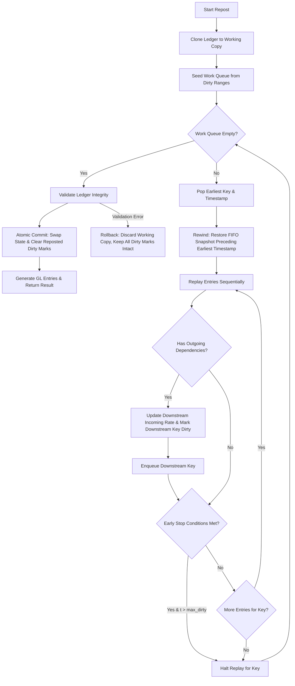

# FIFO Repost Engine — Architecture & System Design

This document details the architectural design, algorithmic decisions, property-test discoveries, and limitations of the standalone `stock_repost` engine.

---

## 1. Answers to Core Design Questions

### Question 1: Affected Transactions
**How are affected transactions identified when a backdated transaction is edited, inserted, or cancelled?**

When a backdated transaction occurs on item $I$ and warehouse $W$ at timestamp $T$:
1. **Intra-Key Propagation**: Every subsequent entry for the tuple $(I, W)$ with $\text{posting\_datetime} \ge T$ is potentially affected. Any change in incoming rate, incoming quantity, or stock consumption alters the subsequent FIFO inventory bins and running valuation.
2. **Inter-Key (Downstream) Propagation**: If any affected transaction on $(I, W)$ is a consumption entry (such as raw material consumed in manufacturing) that has `outgoing_dependencies`, the dependent transactions (e.g., the finished good receipt on $(I_{fg}, W_{fg})$ at $T_{fg}$) are affected. Their incoming rates are recalculated, and all transactions for $(I_{fg}, W_{fg})$ with $\text{posting\_datetime} \ge T_{fg}$ must be recursively re-evaluated.
3. **Dirty Range Tracking**: In our engine, any mutation (`update_entry`, `insert_entry`, `remove_entry`) registers a dirty interval $[\min(\text{dirty}), \max(\text{dirty})]$ on the key. The repost engine seeds its priority queue with all dirty keys, guaranteeing that all directly and indirectly affected transactions are discovered.

---

### Question 2: Recalculation Mechanism
**How are rates and values recalculated across transaction chains and multi-level manufacturing?**

1. **Snapshot Restoration & Queue Replay**:
   - For an affected key $(I, W)$, the engine locates the latest clean entry strictly before $\min(\text{dirty})$.
   - The engine restores the immutable `FifoBin` queue from that entry's `fifo_snapshot` (or starts with an empty queue if rewinding to the beginning).
   - Transactions are replayed sequentially in chronological order (ordered by `(posting_datetime, creation_seq)`).
2. **Receipt Evaluation**:
   - Positive quantity entries push new bins: `FifoBin(qty, incoming_rate)`.
   - Valuation rate is set to `incoming_rate`, and stock value change is $+ (\text{qty} \times \text{incoming_rate})$.
3. **Issue / Consumption Evaluation**:
   - Negative quantity entries consume from the front of the FIFO queue via `FIFOQueue.pop(abs(qty))`.
   - The output valuation rate is the weighted average of the consumed bins: $\text{rate} = \frac{\sum (q_i \times r_i)}{\sum q_i}$.
   - The stock value change is negative: $- \sum (q_i \times r_i)$.
4. **Manufacturing Propagation**:
   - When a consumption entry is tagged with `outgoing_dependencies`, its total consumed valuation $\sum (q_i \times r_i)$ is passed to the manufactured finished good line.
   - The finished good's unit `incoming_rate` is updated to $\frac{\text{consumed value}}{\text{manufactured qty}}$.
   - This mutation marks the finished good key dirty at its posting datetime and enqueues it for re-evaluation.

---

### Question 3: Reposting Design for FIFO
**What is the complete reposting workflow, including queue management, early stopping, and atomicity?**

1. **Work Queue Architecture**: A priority queue holds pending `(posting_datetime, item, warehouse)` tuples, processing the chronologically earliest events first to maintain dependency correctness.
2. **Snapshot Rewind**: Restores state in $O(1)$ without replaying from epoch, leveraging per-entry immutable snapshots.
3. **Early Stopping**: Halts re-evaluation when an entry's rate, balance value, and FIFO queue match pre-existing records, **strictly guarded** by $\text{posting\_datetime} > \max(\text{dirty})$.
4. **Atomic Commit / Rollback**: All recalculations operate on an isolated `working_ledger`. If an `InsufficientStockError` or negative balance occurs anywhere, the entire working copy is discarded. Dirty marks on the original ledger remain untouched for subsequent inspection or correction.

---

### Question 4: Architectural Problems with Running Balance on Every SLE
**Why is maintaining running balance and valuation on every single Stock Ledger Entry problematic in enterprise systems?**

1. **Write Amplification**:
   - Modifying or backdating a single transaction near the start of the year forces updates to thousands of subsequent rows across the database.
2. **Database Locking**:
   - Updating future rows requires exclusive row locks or table range locks, blocking real-time warehouse scanning, sales order shipping, and purchase receipt intake.
3. **Partial Failure & Inconsistent State**:
   - If an unhandled exception or crash occurs midway through updating thousands of rows, the ledger is left in a corrupted hybrid state where half the entries reflect new valuation and the other half reflect stale valuation.
4. **Concurrency Conflicts & Deadlocks**:
   - Multiple background jobs or simultaneous live postings attempting to lock and update overlapping date ranges on the same item/warehouse frequently deadlock or overwrite each other.
5. **General Ledger (GL) Drift**:
   - If inventory subledgers track running balance changes without atomic, synchronized GL adjustments, the balance sheet account *Stock In Hand* drifts out of balance with physical inventory valuation.
6. **Snapshot Bloat**:
   - Serializing large FIFO queue arrays on every row consumes substantial disk space and IO bandwidth, severely inflating table size and index overhead.
7. **Ordering Ambiguity**:
   - Multiple transactions occurring within the same second or minute without strict sequence numbers (`creation_seq`) lead to non-deterministic sorting and unreproducible FIFO allocation.
8. **Negative Stock Vulnerabilities**:
   - A backdated insertion of a stock issue or cancellation of a receipt can cause intermediate balances to drop below zero, invalidating FIFO valuation principles.

---

### Question 5: Implementation Summary

The `stock_repost` engine is structured into clean, decoupled, single-responsibility modules:
- **`models.py`**: Immutable dataclasses (`FifoBin`, `StockLedgerEntry`, `GLEntry`, `RepostResult`, `RepostEntryDiff`) utilizing `Decimal` exclusively for all monetary and quantity fields.
- **`fifo.py`**: Pure, in-memory FIFO queue implementation supporting fractional allocations, immutable snapshotting, and strict negative-stock prevention. Performs no I/O.
- **`ledger.py`**: In-memory stock ledger managing chronological entry indexing, dirty interval tracking (`min_dirty`, `max_dirty`), atomic cloning, and rollback.
- **`repost.py`**: Core reposting engine featuring multi-key dirty seeding, snapshot rewind, early stopping, manufacturing dependency propagation, and atomic state swaps.
- **`gl.py`**: Double-entry bookkeeping engine deriving balanced accounting vouchers from inventory valuation deltas.
- **`report.py` & `cli.py`**: Visual presentation layer rendering before-and-after transaction comparisons, audit summaries, and GL balance verification.

---

## 2. Bugs Found by Property Testing

During automated property-based testing with Hypothesis across diverse transaction sequences, three critical edge-case bugs were discovered and resolved:

### Bug A: Early-Stop Skipping a Second Backdated Edit
- **Symptom**: When two edits were applied to the same item before reposting (e.g. edit at $t_1$ and edit at $t_2$, where $t_1 < t_2$), the repost engine occasionally halted between $t_1$ and $t_2$.
- **Root Cause**: An intermediate transaction between $t_1$ and $t_2$ happened to yield identical valuation rates and balance values to its pre-existing values. The early-stop logic checked convergence without considering that an un-evaluated dirty edit ($t_2$) lay ahead in the future.
- **Fix**: Upgraded `StockLedger` to track both `min_dirty` and `max_dirty` timestamps per key. Early stop is now strictly prohibited unless $\text{current\_entry.posting\_datetime} > \max(\text{dirty})$.

### Bug B: Unprocessed Second Dirty Key in Multi-Key Batches
- **Symptom**: When edits were applied to two separate keys simultaneously (e.g., Raw Material and Finished Good, or two independent items) before triggering a repost, only the target key passed to `repost(item, warehouse)` was recalculated. The second key's dirty entries were ignored.
- **Root Cause**: The repost engine initialized its work queue with only the explicitly passed `(item, warehouse)` argument.
- **Fix**: Seeded the repost work queue with the specified key **plus** all keys currently present in `ledger.dirty_ranges()`.

### Bug C: Dependent Rate Mutation Without Extending Dirty Range
- **Symptom**: In multi-level manufacturing, updating a raw material receipt modified the finished good's incoming rate. However, early-stop on the finished good aborted prematurely, leaving downstream finished good delivery notes with stale valuation.
- **Root Cause**: In `repost.py`, rewriting the finished good's incoming rate via `working_ledger.replace_entry(dep, updated_dep)` enqueued the finished good key, but did not update the working ledger's `max_dirty` for that key. If the finished good already had an earlier dirty timestamp, its `max_dirty` remained in the past, allowing early stop to fire before replaying the rewritten dependent entry.
- **Fix**: Whenever a dependent entry's `incoming_rate` is rewritten during replay, `working_ledger.record_dirty(dep.item, dep.warehouse, dep.posting_datetime)` is explicitly invoked.

---

## 3. Known Limitations

1. **Receipt Cancellation with Active Dependencies**:
   - The cancellation (removal) of a receipt that directly feeds an active manufacturing entry is not currently covered by property testing generators (property generators only cancel receipts with no downstream dependencies to ensure physical validity).
2. **`fifo_snapshot == ()` Heuristic in `_enqueue`**:
   - The queue rewind check (`if prev is not None and prev.fifo_snapshot == () and prev.qty_change != Decimal("0")`) correctly detects uninitialized prior entries, but also triggers when stock is genuinely depleted to zero. This is mathematically safe and verified by test suites, but can cause unnecessary rewinds to the beginning of the ledger for fully depleted items.
3. **In-Memory & Single-Threaded**:
   - The ledger and FIFO engine operate entirely in memory within a single thread. Enterprise database persistence, distributed queue locks, and multi-threaded partition handling are outside the scope of this package.
4. **Manufacturing Overhead / Landed Costs**:
   - Manufacturing vouchers transfer 100% of raw material consumption value directly to finished goods. Additional labor, overhead, scrap value, or landed cost voucher adjustments are not modeled.
5. **"Float" Terminology**:
   - The word "float" appears exclusively as plain English in documentation and docstrings (e.g. describing floating-point risks). Python `float` primitives are strictly forbidden and never used in runtime arithmetic.
