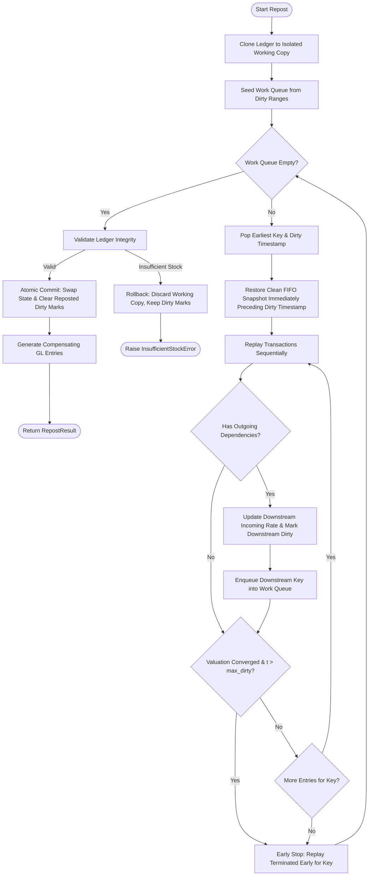

# FIFO Repost Engine

[](https://github.com/<user>/<repo>/actions/workflows/ci.yml)

A high-performance, deterministic FIFO (First-In, First-Out) perpetual stock valuation and reposting engine written in Python 3.11+. In inventory management and ERP systems, backdated transactions, purchase receipt rate adjustments, and inventory cancellations invalidate subsequent stock valuations, running balances, and Cost of Goods Sold (COGS). This engine models stock ledgers, tracks chronological state via immutable FIFO snapshots, and re-evaluates forward valuation across single items and multi-level manufacturing dependencies using an atomic, early-stopping reposting algorithm with zero external runtime dependencies.

---

## Result: Reposting the Task Scenario

When a backdated purchase receipt rate is adjusted (e.g., `PR-01` Milk rate edited from 60 to 80), running the engine CLI produces the following before-and-after audit report:

```
==============================================================================================================
STOCK LEDGER REPOST REPORT
==============================================================================================================
   Voucher    Item             Qty  Rate (B)    Val (B)  BalVal (B) |  Rate (A)    Val (A)  BalVal (A)
--------------------------------------------------------------------------------------------------------------
   OPEN-01    Milk             100        50       5000        5000 |        50       5000        5000
*  PR-01      Milk              50        60       3000        8000 |        80       4000        9000
~  DN-01      Milk             -80         0      -4000        4000 |         0      -4000        5000
~  PR-02      Milk              50        60       3000        7000 |        60       3000        8000
*  MFG-01     Milk            -100         0      -5800        1200 |         0      -6800        1200
*  MFG-01     Milk Powder       10       580       5800        5800 |       680       6800        6800
*  DN-02      Milk Powder      -10         0      -5800           0 |         0      -6800           0
--------------------------------------------------------------------------------------------------------------
Legend: [*] Value Changed   [~] Re-evaluated Only   [ ] Unchanged
```

### Key Numerical Results
- **Milk Consumption in MFG-01**: Valuation out changes from **-5,800 → -6,800** (delta of -1,000).
- **Milk Powder Unit Valuation in MFG-01**: Inbound valuation rate increases from **580 → 680**.
- **Delivery Note DN-02**: COGS out changes from **-5,800 → -6,800** (delta of -1,000).
- **Delivery Note DN-01**: Transaction value remains **completely unchanged at -4,000**, while running balance value shifts from **4,000 → 5,000**.

### The Key Insight
Under strict First-In, First-Out (FIFO) allocation, the 15 Jan Delivery Note (`DN-01`) issues 80 units of Milk entirely from the earlier `OPEN-01` receipt (100 units @ 50). Because `DN-01` did not consume any units from `PR-01`, editing `PR-01` from 60 to 80 **does not alter the valuation of DN-01**. 

However, the subsequent manufacturing entry (`MFG-01`) consumes the remaining 20 units of `OPEN-01` @ 50 (1,000) plus all 50 units of `PR-01` @ 80 (4,000) plus 30 units of `PR-02` @ 60 (1,800), increasing its total consumed value from 5,800 to 6,800. This directly raises the unit cost of Milk Powder from 580 to 680, which in turn cascades to `DN-02`.

---

## Repost Algorithm Flowchart



---

## How to Run

### 1. Environment Setup
Create and activate a virtual environment (Python 3.11+ required):

```bash
python -m venv .venv

# On Linux / macOS:
source .venv/bin/activate

# On Windows (PowerShell):
.venv\Scripts\Activate.ps1
```

### 2. Install Development Dependencies
Install the package in editable mode with development dependencies:

```bash
pip install -e ".[dev]"
```

### 3. Run the Test Suite
Run unit tests, integration tests, and regression tests with `pytest`:

```bash
pytest -q
```

To run with verbose output:

```bash
pytest -v
```

### 4. Run the Interactive CLI Demo
Execute the full scenario demonstration with before/after comparisons and double-entry GL audit:

```bash
python -m stock_repost.cli
```

### 5. Hypothesis Property-Based Testing Profiles
The test suite includes comprehensive property-based tests powered by Hypothesis. You can select profiles using the `HYPOTHESIS_PROFILE` environment variable:

- **`ci`** (50 examples): Fast execution for continuous integration pipelines.
- **`dev`** (300 examples, default): Thorough coverage for local development.
- **`stress`** (1,000 examples): Exhaustive verification across complex multi-item topologies and randomized structural edits.

```bash
# Run with CI profile:
HYPOTHESIS_PROFILE=ci pytest tests/test_property_equivalence.py tests/test_property_structural_edits.py -q

# Run with Stress profile:
HYPOTHESIS_PROFILE=stress pytest tests/test_property_equivalence.py tests/test_property_structural_edits.py -q
```

---

## Project Layout

```
fifo-repost-engine/
├── .github/
│   └── workflows/
│       └── ci.yml               # GitHub Actions CI matrix (Python 3.11 & 3.12)
├── docs/
│   └── erpnext_mapping.md       # Conceptual mapping to ERPNext internals
├── src/
│   └── stock_repost/
│       ├── __init__.py          # Package root and public exports
│       ├── cli.py               # CLI entry point and table renderer
│       ├── fifo.py              # Pure FIFO queue with immutable snapshots
│       ├── gl.py                # Double-entry GL accounting generator
│       ├── ledger.py            # Chronological stock ledger and dirty tracking
│       ├── models.py            # Immutable dataclasses and domain exceptions
│       ├── report.py            # Audit report formatting
│       ├── repost.py            # Multi-key atomic repost engine
│       └── scenario.py          # Reference multi-level task scenario builder
├── tests/
│   ├── conftest.py              # Hypothesis profile registration
│   ├── test_cli.py              # CLI integration tests
│   ├── test_edge_cases.py       # Timestamp ordering & boundary tests
│   ├── test_fifo.py             # Pure FIFO queue unit tests
│   ├── test_gl.py               # Accounting entry unit tests
│   ├── test_gl_labels.py        # Item-specific account label tests
│   ├── test_property_equivalence.py     # Base property-based equivalence tests
│   ├── test_property_structural_edits.py # Structural edits property tests
│   ├── test_regression_property.py      # Deterministic regression test
│   ├── test_report.py           # Report formatting unit tests
│   ├── test_repost_engine.py    # Repost engine integration tests
│   └── test_task_scenario.py   # Multi-voucher scenario verification
├── AGENTS.md                    # Project development constraints and rules
├── DESIGN.md                    # In-depth architectural design and Q&A
├── LICENSE                      # MIT License
├── pyproject.toml               # Package configuration and tool definitions
└── README.md                    # Project documentation and guide
```

---

## Sign Convention

All quantities and monetary values adhere to standard perpetual inventory conventions:
- **Receipts / Inbound**: Quantities are **positive** (`qty_change > 0`). Stock value changes are **positive** (`stock_value_difference > 0`).
- **Issues / Outbound**: Quantities are **negative** (`qty_change < 0`). Stock value changes are **negative** (`stock_value_difference < 0`).
- **Running Balances**: Running quantity (`balance_qty`) and running valuation (`balance_value`) are **non-negative** (`>= 0`).
- **Strict Decimal Arithmetic**: All monetary amounts, unit rates, and quantities use Python `Decimal` with exact quantization. Floating-point arithmetic is never used.
