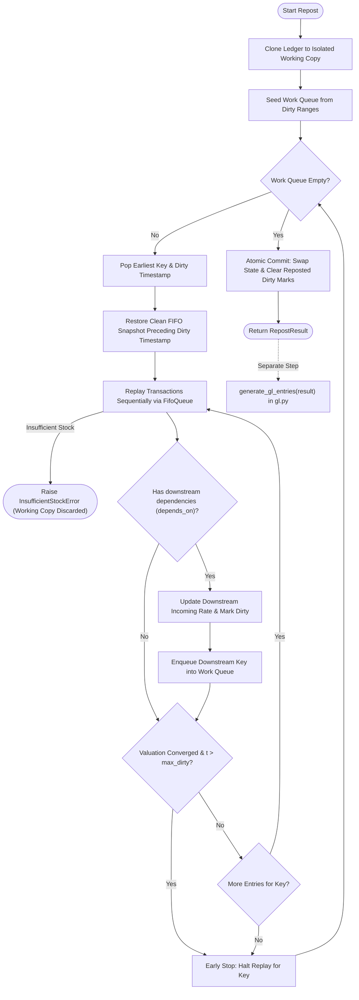

# FIFO Repost Engine

[](https://github.com/nahusha25/fifo-repost-engine/actions/workflows/ci.yml)

## Short Answers
- **Affected Transactions**: Under FIFO the 15 Jan DN value does not change (4,000), but the Manufacture entry and the 25 Jan Powder DN do (+1,000 COGS); affected transactions span subsequent entries on the edited key plus downstream dependents.
- **Recalculation**: Rewinds to the clean snapshot before the earliest edit, replays FIFO allocations forward, and propagates raw material consumption values directly to dependent finished goods.
- **Reposting Design**: Employs a priority queue seeded from dirty ranges, per-entry immutable FIFO snapshots for snapshot-based rewind, early stopping gated strictly by `max_dirty`, and atomic rollback.
- **Running Balance Problems on SLE**: Storing running balances on every SLE causes severe write amplification, database locking, concurrency deadlocks, partial failure corruption, snapshot bloat, and GL drift.
- **Implementation Summary**: A standalone Python 3.11+ library using exact `Decimal` arithmetic, pure `FifoQueue` operations, immutable dataclasses, atomic `StockLedger`, and automated GL reconciliation.
- **Layer Breakdown & Comparison**: See the [FIFO layer walkthrough](DESIGN.md#2-fifo-layer-walkthrough) and [FIFO vs moving average](DESIGN.md#3-fifo-vs-moving-average) sections in DESIGN.md.

---

A deterministic FIFO perpetual stock valuation and reposting engine in Python 3.11+. It models stock ledgers, tracks chronological state via immutable FIFO snapshots, and re-evaluates forward valuation across single items and multi-level manufacturing dependencies using an atomic, early-stopping reposting algorithm with zero external runtime dependencies.

## Result: Reposting the Task Scenario

When a backdated purchase receipt rate is adjusted (`PR-01` Milk rate edited from 60 to 80), running the CLI produces:

```
==============================================================================================================
STOCK LEDGER REPOST REPORT
==============================================================================================================
   Voucher    Item             Qty  Rate (B)    Val (B)  BalVal (B) |  Rate (A)    Val (A)  BalVal (A)
--------------------------------------------------------------------------------------------------------------
   OPEN-01    Milk             100        50       5000        5000 |        50       5000        5000
*  PR-01      Milk              50        60       3000        8000 |        80       4000        9000
~  DN-01      Milk             -80         0      -4000        4000 |         0      -4000        5000
~  PR-02      Milk              50        60       3000        7000 |        60       3000        8000
*  MFG-01     Milk            -100         0      -5800        1200 |         0      -6800        1200
*  MFG-01     Milk Powder       10       580       5800        5800 |       680       6800        6800
*  DN-02      Milk Powder      -10         0      -5800           0 |         0      -6800           0
--------------------------------------------------------------------------------------------------------------
Legend: [*] Value Changed   [~] Re-evaluated Only   [ ] Unchanged
```

**Voucher Timeline**: `PR-01` = 10 Jan, `DN-01` = 15 Jan, `PR-02` = 20 Jan, `MFG-01` = 21 Jan, `DN-02` = 25 Jan.  
**Note**: `(B)` = before, `(A)` = after. Issue rows show rate `0` because incoming rate does not apply to issues.

### Key Numerical Results & Insight
- **Milk Consumption in MFG-01**: Valuation out changes from **-5,800 → -6,800** (delta of -1,000).
- **Milk Powder Unit Valuation in MFG-01**: Inbound valuation rate increases from **580 → 680**.
- **Delivery Note DN-02**: COGS out changes from **-5,800 → -6,800** (delta of -1,000).
- **Delivery Note DN-01**: Transaction value remains **completely unchanged at -4,000**, while running balance value shifts from **4,000 → 5,000**.
- **Key Insight**: Under FIFO, `DN-01` (80 units) is satisfied entirely from `OPEN-01` (100 units @ 50). Because `DN-01` never consumed units from `PR-01`, its value does not change. `MFG-01` consumes the remaining 20 units of `OPEN-01` @ 50, all 50 units of `PR-01` @ 80, and 30 units of `PR-02` @ 60, shifting its cost from 5,800 to 6,800 and cascading to `DN-02`.

A standalone visual report is available at [https://nahusha25.github.io/fifo-repost-engine/demo.html](https://nahusha25.github.io/fifo-repost-engine/demo.html).  
To regenerate: `.venv\Scripts\python examples\generate_demo.py`

See [DESIGN.md](DESIGN.md) for the bugs found by property testing and the known limitations.

---

## Repost Algorithm Flowchart



---

## How to Run

```bash
# 1. Environment & Dependencies
python -m venv .venv && source .venv/bin/activate  # Windows: .venv\Scripts\Activate.ps1
pip install -e ".[dev]"

# 2. Test Suite & CLI Demo
pytest -q
python -m stock_repost.cli

# 3. Hypothesis Property Testing Profiles (ci: 50, dev: 300, stress: 1000)
HYPOTHESIS_PROFILE=ci pytest tests/test_property_equivalence.py tests/test_property_structural_edits.py -q
HYPOTHESIS_PROFILE=stress pytest tests/test_property_equivalence.py tests/test_property_structural_edits.py -q
```

---

## Project Layout

```
fifo-repost-engine/
├── .github/workflows/ci.yml     # GitHub Actions CI matrix (Python 3.11 & 3.12)
├── docs/                        # ERPNext mapping, integration sketch, demo.html
├── examples/                    # Runnable scenario and demo page generator
├── src/stock_repost/            # Core package: models, fifo, ledger, repost, gl, report, cli
├── tests/                       # Unit, edge-case, and Hypothesis property tests
├── DESIGN.md                    # Detailed architectural design and Q&A
├── LICENSE                      # MIT License
└── README.md                    # Project overview and instructions
```

---

## Sign Convention

- **Receipts / Inbound**: Positive quantities (`qty_change > 0`) and positive stock values (`stock_value_difference > 0`).
- **Issues / Outbound**: Negative quantities (`qty_change < 0`) and negative stock values (`stock_value_difference < 0`).
- **Running Balances**: Running quantity and balance value are non-negative (`>= 0`).
- **Strict Decimal Arithmetic**: All monetary amounts, unit rates, and quantities use Python `Decimal`.
